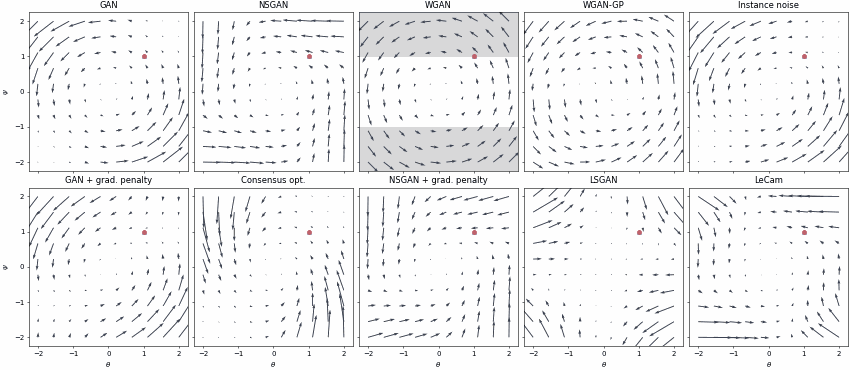
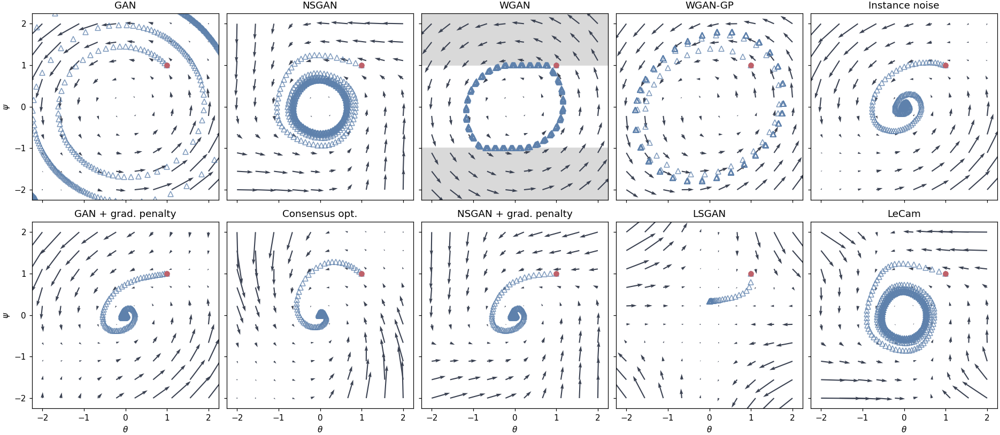
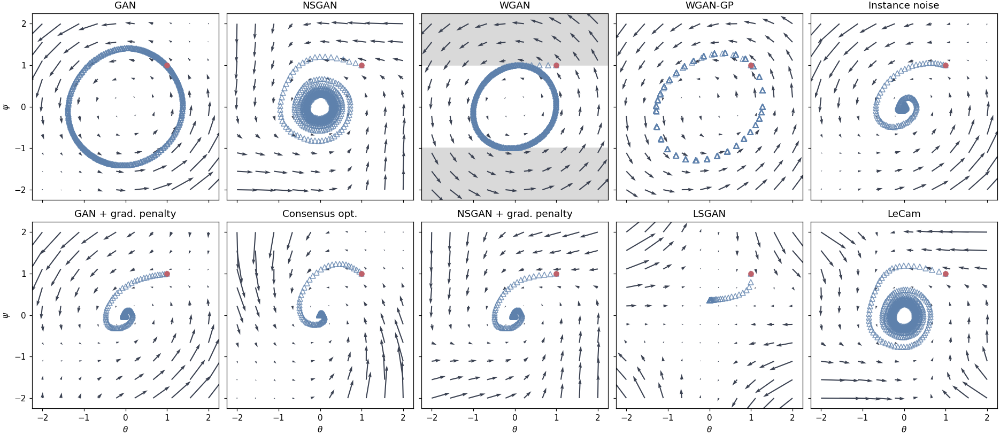
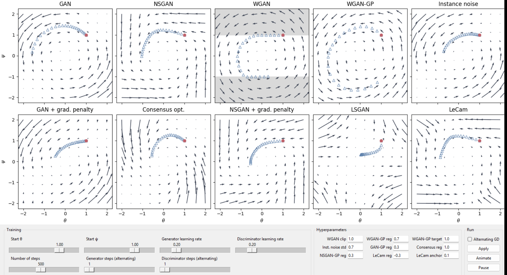

# DiracGAN Explorer

Interactive visualization of GAN training dynamics on the DiracGAN toy problem from
[*Which Training Methods for GANs do actually Converge?*](https://arxiv.org/abs/1801.04406) (Mescheder et al., ICML 2018).
Built as a bonus project for the course *Deep Generative Models* at TU Darmstadt.

<p align="center">
  
</p>

## Background

DiracGAN is the smallest GAN that still shows the training pathologies of real ones.
The real data is a Dirac at $0$, the generator outputs a Dirac at $\theta$, and the discriminator is linear, $D(x) = \psi x$.
The only equilibrium is $(\theta, \psi) = (0, 0)$.

Each panel shows the gradient vector field over $(\theta, \psi)$ and the gradient descent trajectory starting from the red dot.
It is directly visible whether an objective spirals into the equilibrium, orbits it forever, or diverges.

| Objectives | |
|---|---|
| GAN, non-saturating GAN, WGAN, WGAN-GP | unregularized baselines from the paper |
| Instance noise, gradient penalty (GAN / NSGAN), consensus optimization | regularizers from the paper |
| [LSGAN](https://arxiv.org/abs/1611.04076), [LeCam regularization](https://arxiv.org/abs/2104.03310) | added in this project |

## Results

**Simultaneous gradient descent** (lr 0.2, 500 steps). The unregularized GAN diverges, and the WGAN variants orbit the equilibrium without converging.
Instance noise, gradient penalties and consensus optimization converge to $(0, 0)$.



**Alternating gradient descent** with the same settings. The trajectories of the unregularized objectives stay on stable orbiting trajectories instead of diverging.



## GUI



- Changeable start point, learning rates, number of steps and, for alternating GD, the generator/discriminator update ratio.
- Tune each regularizer's hyperparameters (clip value, penalty weights, noise std, LeCam weight and anchor).
- *Apply* draws the full trajectories. *Animate* replays them step by step and can be paused and resumed.

## Getting started

Requires Python ≥ 3.12 with Tk (bundled with the standard Python installers).

With pip:

```bash
pip install numpy matplotlib tqdm
python dirac_gui.py
```

[`DiracGAN.ipynb`](DiracGAN.ipynb) reproduces the original plots from the paper.
The README figures come from `python -m scripts.make_figures`.


## Credits

The `diracgan/` package comes from Lars Mescheder's [GAN_stability](https://github.com/LMescheder/GAN_stability) repository (MIT, see [`diracgan/LICENSE`](diracgan/LICENSE)).
